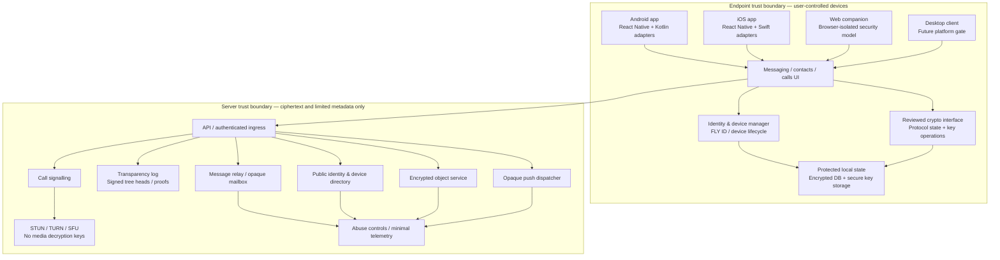
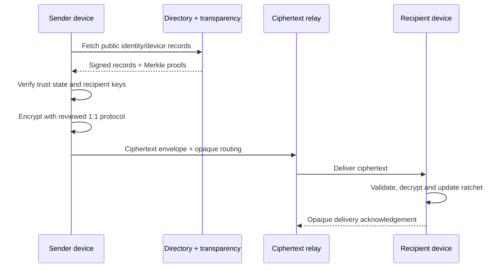
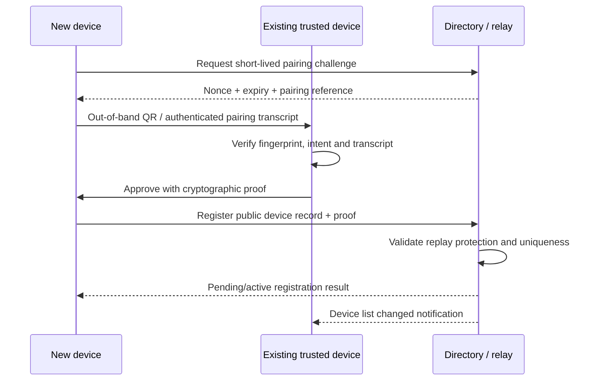
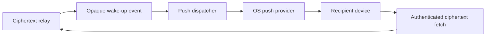
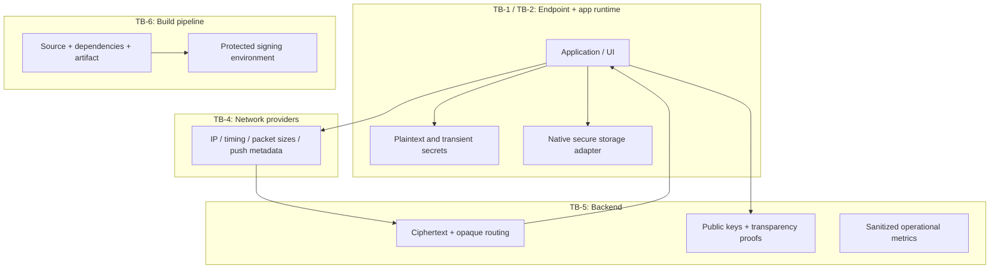
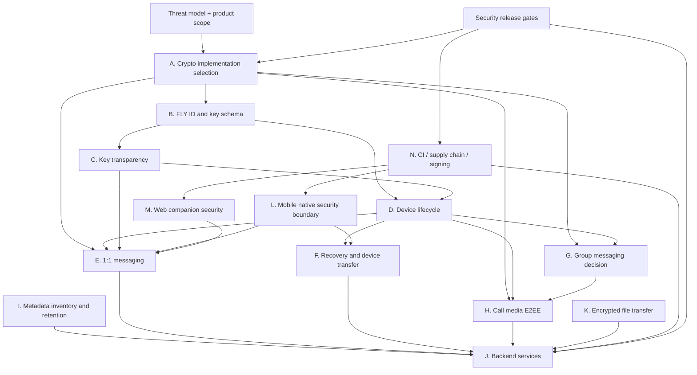

# FLY SECRET — Architecture Consolidation & Security Blueprint

- Phase: 0.3
- Version: 0.3
- Base branch: `security/fly-secret-architecture-adrs-0.2`
- Working branch: `security/fly-secret-architecture-blueprint-0.3`
- Status: Consolidated proposal; architecture approval pending
- Scope: Architecture and security blueprint only; no application code
- Red-Team test status: 27 scenarios remain `NOT_RUN`
- TOR MODE: explicitly excluded from product, architecture, UI, configuration, tests and roadmap
- Decentralization: future-only; excluded from MVP and current release gates except as a documented future threat consideration

> This document consolidates the eleven Phase 0.2 ADRs and the Phase 0.1 security review. It is a design artifact, not proof of implementation, security validation, cryptographic audit, CI execution or release readiness. No ADR is silently promoted to Accepted by this consolidation.

---

## 1. Executive architecture decision

### 1.1 Proposed target

Build FLY SECRET as a **client-controlled E2EE messaging system** with:
- React Native + TypeScript for shared mobile UX and application orchestration.
- Narrow Kotlin/Swift native security adapters for platform key custody, biometrics and protected storage.
- A reviewed, maintained Signal-family implementation for 1:1 messaging, selected only after library/version due diligence.
- MLS as a separate group-messaging candidate; groups remain deferred until a maintained cross-platform implementation and membership/device semantics pass review.
- WebRTC for call transport, with independently designed and reviewed application-level media E2EE; SFrame is an evaluation candidate for SFU media.
- A server-side ciphertext relay, opaque mailbox/routing records, device directory and encrypted object storage. Backend services do not receive message plaintext, private identity/device keys, ratchet secrets, Recovery Kit secrets or media decryption keys.
- A transparency service based on an append-only Merkle log, signed tree heads, consistency/inclusion proofs and independent monitors/witnesses.
- A user-controlled Recovery Kit and trusted-device transfer; no server-side plaintext escrow.
- A separate Web threat model. Initial Web client is a companion client, not assumed to have native hardware-backed key protection.
- A protected GitHub Actions release pipeline, with unprivileged PR CI and isolated production signing.

### 1.2 MVP scope recommendation

**MVP candidate scope:**
1. FLY ID registration without mandatory phone/email.
2. 1:1 E2EE text messaging.
3. Encrypted file/photo transfer after object authorization and metadata controls are specified.
4. Voice messages only after media/file handling gates are defined.
5. Multi-device pairing/revocation with explicit device trust.
6. Recovery Kit and identity re-establishment UX.
7. Contact key verification and transparency status.
8. Android first, then iOS after platform parity review.

**Do not treat as automatically MVP-ready:**
- Group messaging: defer until MLS candidate and group membership/epoch lifecycle are approved.
- Voice/video calls: defer until endpoint media E2EE, signalling authentication, key rotation and ICE privacy are proven.
- Web: limited companion mode only after independent Web gates; otherwise defer.
- Desktop: later platform target, not a shortcut around Web security.
- Decentralized infrastructure: future-only.

This is a scope recommendation, not an implementation commitment. The product owner must explicitly approve the release scope.

---

## 2. Reconciliation of the 11 ADRs

### 2.1 Consolidated decision matrix

| ADR | Consolidated position | Dependency | Blocking question |
|---|---|---|---|
| 001 Crypto stack | Reviewed implementations only; no custom crypto | Foundational | Which exact library/version/license/platform matrix? |
| 002 FLY ID | Random opaque identifier; separate key domains | 003, 004, 005 | Exact ID encoding and registration proof? |
| 003 Transparency | Merkle log + monitors + gossip/witnesses | 001, 002 | Who operates witnesses and what is freshness policy? |
| 004 Multi-device | Per-device keys and sessions; explicit approval/revoke | 001, 002, 005, 006, 007 | Pairing protocol, revocation semantics and device cap? |
| 005 Recovery | Trusted-device transfer + client-encrypted Recovery Kit | 001, 002, 004 | Exact recovery container, KDF, AEAD and lineage semantics? |
| 006 Messaging | Signal-family 1:1; MLS candidate for groups | 001, 002, 004 | Are groups deferred from MVP? |
| 007 Calls | WebRTC transport + application media E2EE | 001, 004, 006 | Exact media E2EE/key-management design? |
| 008 Metadata | Minimize and bound metadata; opaque push | All services | Data inventory, retention and contact discovery design? |
| 009 Mobile | RN shared app + narrow native modules | 001, 004, 005 | Which storage/crypto APIs and supported OS versions? |
| 010 Web | Companion model, distinct browser security gates | 001, 002, 004, 008 | Is Web explicitly post-MVP? |
| 011 Supply chain | Unprivileged CI; protected signing | All artifacts | Which release environment and signing custody? |

### 2.2 Contradictions and ambiguities resolved by this blueprint

1. **“Signal-family” is a protocol direction, not a selected dependency.** ADR-001 and ADR-006 could be misread as a final library decision. They are not. The exact implementation, version, license, maintenance and platform coverage remain unresolved. No implementation may invent compatibility or silently substitute another protocol.
2. **MLS is not an approved group implementation.** ADR-006 recommends evaluation only. To prevent an accidental security downgrade, group messaging is deferred from the initial release unless a dedicated group ADR amendment closes all criteria.
3. **Device transfer and Recovery Kit are distinct operations.** ADR-004 and ADR-005 are reconciled as: transfer from an existing trusted device; offline/user-controlled Recovery Kit when no trusted device remains; identity re-establishment when recovery material is lost. They must not share an ambiguous “restore account” flow.
4. **FLY ID is not a cryptographic identity key.** ADR-002 requires separate identifiers and keys. The public ID must never be treated as proof of possession, a secret, a session key or a stable transport routing token.
5. **Transparency is not a standalone Merkle database.** ADR-003 requires independent monitors/witnesses and cross-client comparison. Without gossip or witness diversity, a log operator may still present split views.
6. **Verified status is version-bound.** Any identity/device key change, recovery lineage change or failed consistency proof invalidates the previous Verified state. A boolean contact flag is insufficient.
7. **Web cannot inherit mobile security claims.** ADR-010 is stricter than a generic cross-platform parity goal. Browser compromise, XSS and extension access remain a separate trust boundary.
8. **WebRTC does not equal E2EE.** ADR-007 requires media-layer encryption and independent validation of SFU key isolation. DTLS-SRTP is transport protection only.
9. **“Opaque push” does not mean metadata-free.** Push providers, IP/network operators, timing and token mappings can still create correlation. ADR-008 must define a field-level data inventory and retention.
10. **Recovery has an unavoidable availability/security trade-off.** No server escrow means losing all devices and recovery material can mean permanent identity/data loss. UX must state this before the user depends on the account.
11. **Decentralization is not an MVP dependency.** DEC scenarios remain documented as future risks only. Do not add consensus, node discovery, Sybil defenses or peer-routing into current architecture.
12. **CI workflow presence is not FLY CI readiness.** The previously inspected repository Android workflow targets another application path. ADR-011 remains a design requirement until a FLY-specific workflow is separately implemented and verified.

### 2.3 Cross-cutting gaps to close before implementation

- Concrete crypto implementation/version shortlist and independent review scope.
- Canonical identity/key/device/session schema and key rotation semantics.
- Transparency log operator, witness independence, gossip mechanism, freshness threshold and outage behavior.
- Pairing protocol, authorization transcript, device revocation propagation and concurrent device-link race behavior.
- Recovery container format, memory-hard KDF parameters, AEAD selection, one-time transaction semantics, rate limits and recovery lineage UX.
- Message envelope format, idempotency, ordering, replay handling, TTL and server retention.
- Group protocol decision and group membership/epoch semantics (or explicit MVP deferral).
- Call signalling authentication, media key management, frame encryption, rekey and ICE/IP disclosure policy.
- File upload/download authorization, object expiry, MIME/parser limits, EXIF stripping and temporary-file lifecycle.
- Field-level metadata inventory, retention schedule, legal/abuse exceptions, telemetry allowlist and contact discovery design.
- Android/iOS supported OS/device matrix, browser matrix and Web exclusion criteria.
- CI action pins, runner trust, build reproducibility, SBOM/provenance and protected signing custody.
- Incident response, key compromise response, dependency vulnerability response and security release owner.

---

## 3. Target logical architecture

### 3.1 Component map

**Interpretation:** client crypto and local key custody are inside the endpoint boundary. Server components are not trusted with plaintext or decryption secrets. The diagram is logical: it does not imply any service is implemented or deployed.

### 3.2 Service responsibilities and prohibited data

| Component | May process/store | Must never receive/store |
|---|---|---|
| API ingress | Authenticated requests, rate-limit signals, opaque IDs | Message plaintext, private keys, recovery secrets |
| Identity/device directory | FLY ID, public identity/device keys, signed device records, limited status | Private identity/device keys |
| Transparency log | Public key bindings, signed tree heads, proofs | Private keys, plaintext conversations |
| Message relay/mailbox | Ciphertext envelopes, opaque recipient routing, bounded delivery metadata | Plaintext, ratchet secrets, decryption keys |
| File service | Client-encrypted blobs, opaque object IDs, authorization metadata | File plaintext or content keys |
| Push dispatcher | Opaque wake-up token and push token mapping under restricted access | Message preview, sender/recipient plaintext identity, content keys |
| Call signalling | Authenticated signalling envelopes and necessary session metadata | Media plaintext or media decryption keys |
| TURN/SFU | Encrypted packets/frames and network metadata necessary for routing | E2EE media keys or decoded media |
| Observability | Allowlisted aggregate metrics, sanitized errors | Plaintext, private keys, recovery material, raw message bodies |

The backend may still observe some delivery, timing, size, network and routing metadata. “E2EE” must not be marketed as “no metadata.”

---

## 4. Trust boundaries

### TB-1 — User endpoint and OS

**Assets:** identity/device private keys, ratchet state, local plaintext, recovery material, decrypted media.
**Threats:** malware, root/jailbreak, OS compromise, screen capture, memory inspection, malicious accessibility services, physical access.
**Controls:** secure hardware-backed storage where available, narrow native APIs, encrypted local DB, biometric/PIN gating, OS update policy, app hardening, screen protections where appropriate, secret minimization.
**Residual risk:** compromised endpoint can access data while unlocked; FLAG_SECURE is not protection from external cameras or all privileged capture.

### TB-2 — JavaScript runtime / React Native bridge

**Assets:** transient plaintext and operation requests; should not be long-term key custody.
**Threats:** dependency compromise, instrumentation, bridge misuse, accidental logging, runtime memory exposure.
**Controls:** narrow typed bridge contract, no raw private-key export, dependency pinning, no secrets in JS persistent storage, redacted diagnostics.
**Residual risk:** a compromised app/runtime can still observe data passed to it. Native modules do not make a compromised endpoint safe.

### TB-3 — Web browser runtime

**Assets:** active session, displayed plaintext, transient cryptographic material.
**Threats:** XSS, malicious extensions, compromised origin/CDN, service-worker takeover, browser storage extraction.
**Controls:** strict CSP, Trusted Types where available, no third-party scripts on sensitive origin, dependency review, controlled service-worker lifecycle, minimal persistence, independent browser testing.
**Residual risk:** browser extensions and endpoint malware may observe active content. No claim of hardware-backed parity with native clients.

### TB-4 — Network and push providers

**Assets exposed:** IP addresses, timing, packet sizes, push tokens and delivery timing.
**Threats:** traffic correlation, token-to-identity mapping, network observation, denial of service.
**Controls:** opaque push, TLS, identifier separation, minimal retention, careful relay topology, documented disclosure.
**Residual risk:** timing and network metadata cannot be assumed hidden.

### TB-5 — Backend operators and storage

**Assets exposed:** ciphertext, public keys, routing/mailbox metadata, encrypted file blobs, limited account/device state.
**Threats:** insider access, database breach, split-view, IDOR, log leakage, queue exhaustion.
**Controls:** least privilege, service isolation, object-level authorization, transparency proofs, retention enforcement, encrypted storage, audited access, abuse controls.
**Residual risk:** malicious service can deny, delay, reorder or correlate traffic even if it cannot decrypt it.

### TB-6 — Build and release supply chain

**Assets:** source, dependencies, build artifacts, signing credentials.
**Threats:** compromised actions, malicious dependency, runner compromise, artifact substitution, signing secret exfiltration.
**Controls:** immutable action pins, locked dependencies, minimal permissions, protected release environment, isolated signing, SBOM, provenance, checksums and review.
**Residual risk:** signing trust and maintainer accounts remain high-value attack targets.

### TB-7 — Peer devices and conversation participants

**Assets:** plaintext after delivery, keys on recipient endpoint, exported files/screenshots.
**Threats:** malicious recipient, forwarding, compromised peer device, stale device sessions.
**Controls:** per-device sessions, verified fingerprints, device revocation, clear disappearing-message limits.
**Residual risk:** cannot prevent an authorized recipient from photographing, copying or independently retaining displayed content.

---

## 5. Data classification and lifecycle

| Data class | Examples | At rest | In transit | Retention rule |
|---|---|---|---|---|
| Secret cryptographic material | Private identity/device keys, ratchet secrets, Recovery Kit secret, media keys | OS secure storage / reviewed encrypted local storage; never server-side | Never sent to backend in plaintext | Rotate/revoke per protocol; securely delete where feasible |
| User plaintext | Messages, voice, decoded media, file contents | Local encrypted DB/cache with bounded temporary copies | E2EE ciphertext only outside endpoints | User-controlled lifecycle plus disclosed recipient-copy limitation |
| Public cryptographic records | Public keys, fingerprints, signed device records, transparency proofs | Directory/log with integrity controls | Authenticated and signed | Versioned; append-only history where required |
| Ciphertext payload | Encrypted message envelopes and file blobs | Server queue/object storage | TLS plus application E2EE | TTL and deletion policy; ciphertext is not automatically harmless metadata |
| Routing metadata | Opaque mailbox IDs, delivery state, timestamps, sizes | Minimized server storage | Protected transport | Explicit short retention; exact values require policy decision |
| Network metadata | IP, ICE candidates, TURN allocation | Avoid persistent storage unless required | Inherent to network operation | Operationally bounded and disclosed |
| Telemetry | Error codes, coarse performance metrics | Allowlisted sanitized store | Authenticated | No content or secrets; bounded retention |
| Push metadata | Push token, opaque wake-up token | Restricted mapping store | Provider transport | Rotatable, separable from FLY ID, bounded retention |

### 5.1 Message lifecycle

1. Sender resolves recipient public identity/device records and validates transparency proofs.
2. Sender client creates/updates protocol sessions for each target device using the selected reviewed protocol.
3. Sender encrypts locally and creates a bounded ciphertext envelope with version, recipient routing token, expiry and idempotency data. Envelope schema remains a specification task.
4. Relay stores/forwards ciphertext and limited routing metadata; it cannot decrypt.
5. Recipient device validates envelope bounds, protocol state and replay/idempotency conditions, then decrypts locally.
6. Local plaintext is persisted only according to local storage policy; UI indicates delivery/read semantics without leaking content to push.
7. Expiry is enforced by client and server retention controls, but does not erase recipient exports, offline copies, screenshots or external captures.

### 5.2 File lifecycle

1. Client validates size/type and strips EXIF/GPS metadata where applicable.
2. Client encrypts file and creates a separate content key under the reviewed crypto design.
3. Server authorizes object access per recipient/device and stores only ciphertext.
4. Recipient downloads ciphertext and decrypts locally.
5. Temporary files, thumbnails, share-sheet copies and caches follow a defined cleanup policy.
6. Object expiry/revocation does not promise deletion of copies already downloaded.

### 5.3 Recovery lifecycle

- Existing trusted device available → authenticated, short-lived device transfer.
- No trusted device but Recovery Kit available → client-side recovery with replay/race protections and explicit device/session rotation.
- Neither available → identity re-establishment; old identity cannot silently be restored or marked Verified.
- Any recovery event produces a visible trust transition to contacts and invalidates stale device approvals.

### 5.4 Call lifecycle

1. Authenticate signalling participants and bind session to verified identity/device state.
2. Negotiate WebRTC transport; STUN/TURN/ICE metadata is separately assessed.
3. Establish application media E2EE keys using reviewed key-management design.
4. Encrypt media frames before SFU routing; SFU sees ciphertext only.
5. Rotate keys on membership/device change and terminate stale sessions.
6. Test SFU compromise/key isolation and signalling substitution before claiming E2EE calls.

---

## 6. Data-flow diagrams

### 6.1 1:1 message delivery

No server component participates in plaintext encryption/decryption. The exact protocol handshake and envelope are determined only after ADR-001 acceptance.

### 6.2 Device linking

The server never receives the private device key. Exact transcript signature and proof-of-possession scheme remain open until crypto library selection.

### 6.3 Push wake-up

Push body contains no message content, sender name, FLY ID, recipient FLY ID or content key. Push token mapping is sensitive metadata and must be separately access-controlled and rotatable.

### 6.4 Trust-boundary overview

---

## 7. Dependency map and implementation order

### 7.1 Dependency graph

### 7.2 Critical path

1. Approve product scope and threat model.
2. Select and review crypto implementation(s).
3. Freeze identity, device and session entity model.
4. Define transparency proofs and trust UX.
5. Define device linking/revocation and recovery semantics.
6. Define canonical message envelope and 1:1 session lifecycle.
7. Build minimal backend relay and object authorization around ciphertext-only invariants.
8. Implement native key custody and local encrypted storage.
9. Add file transfer and metadata lifecycle.
10. Evaluate groups and calls independently; do not allow them to delay or weaken 1:1 security.
11. Build separate Web security path only after browser gates.
12. Harden CI/release pipeline before distributable signed builds.
13. Run the full threat-driven test matrix and independent security review before release.

### 7.3 Parallelizable work after foundational decisions

- UX wireframes for FLY ID, verification, device list, recovery warnings and security center.
- Backend API contract design that contains no plaintext/secret fields.
- CI hardening design and SBOM/provenance policy.
- Data inventory, privacy notice and retention policy.
- Platform compatibility research.

These may proceed as documentation/specification work; they must not invent crypto parameters or claim security properties without implementation evidence.

---

## 8. Proposed implementation phases and exit criteria

| Phase | Work package | Exit criteria |
|---|---|---|
| 0.4 | Decision closure / ADR acceptance | All blocking ADR questions resolved; exact dependencies and scope signed off |
| 1.0 | Identity and device foundation | FLY ID schema, key binding, registration replay defenses, device lifecycle specified and tested |
| 1.1 | Transparency | Log/proof/witness design implemented; split-view and rollback tests pass |
| 1.2 | Local security foundation | Native key custody, encrypted DB, backup exclusions, secret-free diagnostics validated |
| 1.3 | 1:1 messaging | Reviewed protocol integrated; replay, reorder, rollback, skipped-key and multi-device tests pass |
| 1.4 | Recovery | Device transfer + Recovery Kit + re-establishment; theft/replay/race tests pass |
| 1.5 | Files and privacy | IDOR, EXIF, parser/resource, expiry and metadata tests pass |
| 1.6 | Groups (conditional) | MLS candidate approved; membership/epoch/device lifecycle tests pass; otherwise explicitly deferred |
| 1.7 | Calls (conditional) | Application media E2EE, signalling, key rotation and ICE privacy tests pass; otherwise deferred |
| 1.8 | Web companion (conditional) | Independent browser threat model, XSS/CSP/dependency/session tests pass |
| 1.9 | Release engineering | Protected GitHub Actions, SBOM, provenance, signing separation and artifact verification pass |
| 2.0 | Release candidate | All applicable gates PASS, independent review closed, incident/rollback plan approved |

No phase can treat `NOT_RUN` or `BLOCKED` as PASS. A test can be N/A only with written scope rationale and reviewer approval. Critical risks block release until remediation and regression evidence exist.

---

## 9. Security invariants — non-negotiable

1. Backend never receives message plaintext, private identity/device keys, ratchet secrets, Recovery Kit secrets or media decryption keys.
2. FLY ID is never a password, bearer token or cryptographic key.
3. Identity, device, session and transport identifiers are separate.
4. No custom cryptographic primitives, ratchets, handshakes or media ciphers.
5. No silent key substitution, key downgrade, ratchet rollback or replay acceptance.
6. A key change invalidates old Verified state until re-verification.
7. New device linking requires explicit cryptographic approval and replay-safe challenge binding.
8. Revocation prevents future access where protocol and server controls permit; it cannot erase data already received.
9. Push payload contains no message plaintext or identifying message preview.
10. File access is object-authorized per identity/device; object IDs are not authorization.
11. Web is not granted native security claims or parity by default.
12. DTLS-SRTP alone is never labelled end-to-end media encryption.
13. Production signing secrets are never exposed to PR builds, repository files, logs, artifacts or chat.
14. Disappearing messages do not promise deletion of screenshots, exports, offline copies or recipient-controlled backups.
15. TOR MODE remains absent from all current scope.
16. Decentralization remains future-only; no current dependency on peer consensus or decentralized routing.

---

## 10. Security release evidence required

Before a public release, retain a release evidence bundle containing:
- Release tag, commit SHA, build artifact hash and toolchain versions.
- Accepted ADR versions and documented deviations.
- Exact crypto library names/versions, license, audit references and configuration.
- SBOM, dependency review output and build provenance/attestation.
- Test matrix with actual PASS/FAIL/BLOCKED/NOT_RUN states and reproducible evidence.
- Red-Team scenario results with sanitized logs and no secret material.
- Key transparency monitor/witness evidence and key-change UX tests.
- Recovery and device-revocation test evidence.
- Privacy data inventory, retention controls and logging review.
- Call E2EE/SFU validation if calls are in release scope.
- File authorization/parser/metadata validation if file transfer is in release scope.
- Platform/browser compatibility and threat-model-specific test reports.
- Signing approval, key custody record, revocation/rotation plan.
- Incident response, vulnerability disclosure and rollback plan.
- Independent reviewer sign-off.

---

## 11. Open decision register for Phase 0.4

| ID | Decision required | Suggested owner | Blocks |
|---|---|---|---|
| D-01 | Approve exact 1:1 crypto implementation/version and license | Security/crypto reviewer | Identity sessions, messaging |
| D-02 | Approve MLS candidate or explicitly defer groups | Security architect/product owner | Group messaging |
| D-03 | Approve FLY ID format and registration challenge protocol | Identity architect | Registration |
| D-04 | Approve transparency log/witness model and freshness policy | Security architect | Verified contacts |
| D-05 | Approve device pairing/revocation protocol | Mobile/security leads | Multi-device |
| D-06 | Approve Recovery Kit format/KDF/AEAD and lineage semantics | Crypto reviewer/product owner | Recovery |
| D-07 | Approve message envelope, TTL, idempotency and retention | Messaging/backend leads | Relay |
| D-08 | Approve file key/metadata/authorization model | Security/backend leads | File transfer |
| D-09 | Approve call media E2EE and signalling/key management | Media/security leads | Calls |
| D-10 | Approve metadata inventory, retention and contact discovery | Privacy/security owner | Production data services |
| D-11 | Approve native storage and RN bridge contracts | Mobile leads | Mobile implementation |
| D-12 | Approve Web companion scope and browser support matrix | Product/security owner | Web |
| D-13 | Approve CI runner, action pins, protected signing and provenance | Release engineering | Signed APK |
| D-14 | Approve MVP platform/feature cut (Android-first recommendation) | Product owner | Delivery plan |

---

## 12. Phase 0.3 status and verification boundaries

- 11 ADRs consolidated: yes, as proposed decisions.
- Cross-ADR conflicts and gaps recorded: yes.
- Logical target architecture and service boundaries documented: yes.
- Data flows and trust boundaries documented: yes.
- Dependency map and implementation sequence documented: yes.
- Security invariants and release evidence requirements documented: yes.
- ADRs formally accepted: no.
- Application code written: no.
- Tests executed: no; Red-Team scenarios remain 27 × `NOT_RUN`.
- APK built: no.
- FLY-specific GitHub Actions pipeline implemented or run: no.
- `main` modified: no.
- TOR MODE: excluded.
- Decentralization: future-only.

**Phase 0.3 exit:** documentation blueprint prepared. Proceed to Phase 0.4 only after product/security owners resolve the open decision register and formally accept or amend the blocking ADRs.
